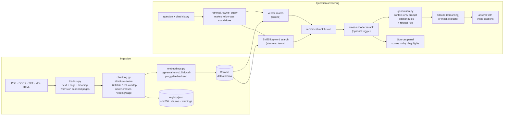

# doc-rag

Chat with your documents and get answers that are **grounded in the files you
uploaded**, with inline citations down to the page (`[report.pdf, p.4]`) or the
section (`[handbook.md, § Leave policy]`). Drop in PDFs, Word files, text,
Markdown or HTML; ask questions; see exactly which passages the answer came
from, and how they were retrieved.

Retrieval runs on a **local embedding model, so no API key is needed to index
and search**. Generation uses the Anthropic API, and `MOCK_LLM=1` makes the
whole demo work offline by answering with the top retrieved passages.

---

## Architecture



---

## Quick start

```bash
make setup            # creates .venv and installs everything (CPU torch wheels)
make ingest-samples   # indexes the two bundled sample documents
make app              # opens the Streamlit chat UI
```

On Windows without GNU make, the same targets are in a PowerShell shim:

```powershell
./make.ps1 setup ingest-samples app
```

No API key? Run everything in mock mode - retrieval is real, the "answer" is
the top passages with their citations:

```bash
# bash
MOCK_LLM=1 make app
# or, headless:
make demo
```

With a key, put it in `.env` (copy `.env.example`):

```ini
ANTHROPIC_API_KEY=sk-ant-...
LLM_MODEL=claude-opus-5-5
MOCK_LLM=0
```

First run downloads two small models from Hugging Face: the embedding model
(~130 MB) and, only if you switch the reranker on, a cross-encoder (~90 MB).

---

## Demo script

Five minutes, from a clean clone:

1. **`make setup && make ingest-samples`**
   The policy sample is rendered to a real 3-page PDF first, so you can see
   page-level citations. Expect:
   ```
   rendered northwind-remote-work-policy.pdf from northwind-remote-work-policy.txt
     [ok]   aurora-sparrow-field-guide.md: 8 chunks
     [ok]   northwind-remote-work-policy.pdf: 13 chunks, 3 pages
   ```
2. **`make app`**, then ask: *"What is the wingspan of an Aurora Sparrow?"*
   You get `24 centimetres` with a citation to the field guide. Open
   **Sources** to see the passages, their fused scores, whether each came from
   vector search, keyword search or both, and the matched text highlighted.
3. Ask a follow-up that only makes sense in context: *"And its mass?"*
   The caption above the answer shows the rewritten, standalone query that was
   actually searched.
4. Ask something the documents do not cover: *"How many vacation days do
   employees get each year?"* →
   **"I couldn't find that in the documents."**
5. Click **Summarize** next to a document in the sidebar for a cited summary,
   or try one of the auto-suggested questions above the chat.
6. Switch on **Cross-encoder reranking** in the sidebar and re-ask a question -
   the Sources panel now shows a reranker score per passage.
7. Upload the same file twice: the second upload is skipped by SHA-256, so the
   index never gets duplicate chunks. Delete a document and its chunks go too.
8. **`make eval`** for the metrics table, **`make test`** for the test suite.

---

## How it works

**Ingestion** (`src/docrag/loaders.py`, `chunking.py`)
PDF text is extracted per page with `pypdf`; because PDF extraction loses blank
lines, paragraphs and headings are rebuilt from line structure. DOCX uses the
real paragraph styles; Markdown uses `#` headings and keeps code fences whole;
HTML uses `h1..h6`/`p`/`li` via BeautifulSoup; plain text falls back to blank
lines plus a heading heuristic. Pages with almost no extractable text produce a
warning ("probably a scan - run OCR"), surfaced in the sidebar instead of
silently indexing nothing.

Chunking is structure-aware: a chunk never spans two headings or two pages, is
filled to ~650 tokens (hard cap 800, heading prefix included in the budget),
splits over-long paragraphs on sentence boundaries, and carries ~12% of the
previous chunk's trailing sentences as overlap - but never across a section or
page boundary, so overlap cannot create a citation that points at the wrong
page. Every chunk stores `filename`, `page`, `heading`, `chunk_id`, `doc_id`.

**Storage** (`store.py`)
A persistent Chroma collection plus `data/registry.json` (one record per
document: SHA-256, chunk count, pages, warnings, suggested questions).
Re-uploading identical bytes is detected by hash and skipped; `force=True`
replaces. Deleting a document removes its chunks and its record. Multiple
collections are supported via `COLLECTION`, and a mismatch between the stored
embedding dimension and the current backend is reported rather than corrupting
the index.

**Retrieval** (`retrieval.py`)
Vector search and BM25 each return up to `CANDIDATE_K` candidates, fused with
reciprocal rank fusion (`score = Σ 1/(k + rank)`, `k = 60`), which needs no
score normalisation between the two retrievers. An optional cross-encoder
reranks the top of the fused list. Both retrievers share a stemmed term space,
so "incubates" finds "incubation". Follow-up questions are rewritten into
standalone ones - with the LLM when one is available, otherwise by appending
the previous turn's keywords. Filtering by document is a metadata filter on
both retrievers.

**Generation** (`generation.py`)
The system prompt allows only the retrieved passages, requires an inline
citation copied verbatim from each passage's `cite` attribute, and requires the
exact sentence *"I couldn't find that in the documents."* when the passages do
not answer the question. Answers stream. The answer text is parsed back for
citations, which is how the Sources panel marks which passages were actually
used.

**Mock mode** returns the best-matching sentences from the top passages with
their citations. Since there is no model to judge groundedness, it uses a
lexical gate: the question's topic words (stemmed, generic question words like
"how long" removed, weighted by corpus rarity) must be ≥ `MOCK_MIN_COVERAGE`
covered by the retrieved text, otherwise it refuses. Measured on the sample
set, vector similarity alone does *not* separate answerable from unanswerable
questions (an out-of-scope question scored 0.80 while an answerable one scored
0.73), which is why the gate is lexical.

---

## Configuration

All settings are environment variables, read from `.env` (see `.env.example`).

| Variable | Default | Notes |
|---|---|---|
| `MOCK_LLM` | `0` | `1` = no LLM call, answers are the top passages |
| `LLM_PROVIDER` / `LLM_MODEL` | `anthropic` / `claude-opus-5-5` | `mock` is also a provider |
| `ANTHROPIC_API_KEY` | - | not needed for indexing or search |
| `LLM_EFFORT` | `low` | `low…max`; grounded extraction needs little |
| `JUDGE_MODEL` | `claude-haiku-5-5` | eval faithfulness judge only |
| `EMBEDDING_BACKEND` | `sentence-transformers` | or `hash` (no torch, works offline) |
| `EMBEDDING_MODEL` | `BAAI/bge-small-en-v1.5` | any sentence-transformers model |
| `COLLECTION` | `doc_rag` | separate collections = separate libraries |
| `CHUNK_TARGET_TOKENS` / `CHUNK_MAX_TOKENS` | `650` / `800` | |
| `CHUNK_OVERLAP_RATIO` | `0.12` | 12% of the target, whole sentences |
| `TOP_K` / `CANDIDATE_K` / `RRF_K` | `6` / `24` / `60` | |
| `USE_RERANKER` / `RERANKER_MODEL` | `0` / `ms-marco-MiniLM-L-6-v2` | UI toggle overrides |
| `MOCK_MIN_COVERAGE` | `0.75` | mock-mode refusal threshold |

---

## Evaluation

```bash
make eval                                    # bundled 11-case test set
python scripts/eval.py --k 5 --rerank        # more passages + cross-encoder
python scripts/eval.py --generate 3 --save-generated data/generated_qa.json
```

The test set (`data/samples/qa_testset.json`) is hand-written against the two
sample documents: nine answerable questions with the exact facts they must
contain, and two out-of-scope questions that must be refused. `--generate N`
additionally asks the LLM for N questions per document (needs an API key).

Metrics printed: **hit-rate@k** and **MRR** over gold chunks (right file, right
page when specified, containing the expected fact), **answer key facts** (exact
string match on the expected facts), **correct refusals**, and
**faithfulness** via LLM-as-judge (automatically skipped in mock mode).

Last run on this machine, mock mode with `bge-small-en-v1.5`, `k=6`:

| metric | value |
|---|---|
| hit-rate@6 | 100.0% |
| MRR | 0.796 |
| answer key facts | 100.0% |
| correct refusals | 100.0% |
| faithfulness (judge) | n/a (mock) |

With `--rerank --k 5`, MRR rises to 0.837.

---

## Tests

```bash
make test        # 59 tests, ~6 s, no network and no API key
```

Covered: every loader (including a genuine generated PDF and DOCX, scanned-page
warnings, unsupported types), chunk boundary rules (heading, page, token
budget, sentence splitting, overlap, overlap *not* leaking across sections),
RRF maths and BM25 behaviour, citation formatting/parsing/highlighting, an
end-to-end pass over the sample documents with a mocked LLM (ingest → dedup →
retrieve → cited answer → refusal → document filter → delete) and the eval
harness itself. `tests/test_app_smoke.py` runs `app.py` headlessly through
Streamlit's own `AppTest`, so the UI is covered too: it renders, answers a
question with a citation, and refuses an out-of-scope one.

---

## Project layout

```
app.py                  Streamlit UI (upload, chat, sources, summarize)
src/docrag/
  config.py             env-driven settings
  loaders.py            PDF / DOCX / TXT / MD / HTML -> blocks with page+heading
  chunking.py           structure-aware splitter with overlap
  embeddings.py         pluggable embedding backends (local model, hash)
  store.py              Chroma collection + document registry (dedup, delete)
  retrieval.py          vector + BM25 + RRF + reranker + query rewriting
  generation.py         prompts, Anthropic streaming client, mock LLM, judge
  citations.py          citation format/parse, highlighting, context building
  pipeline.py           DocRag façade: ingest / ask / summarize
  evaluation.py         metrics and the eval runner
  pdfwrite.py           minimal PDF writer (sample PDF + test fixtures)
scripts/                ingest_samples.py, eval.py, demo.py, clean.py
tests/                  loaders, chunking, fusion, citations, end-to-end
data/samples/           two sample documents + the Q&A test set
```

---

## How to improve this

- **OCR for scanned pages.** Pages with no text layer are currently flagged,
  not read. Route them through Tesseract (`pytesseract` + `pdf2image`) or a
  cloud OCR, and keep a per-page `needs_ocr` flag so re-ingestion is cheap.
- **Multi-modal.** Tables and charts lose meaning as flat text. Extract tables
  with Camelot/`pdfplumber` into Markdown, render figures as images and send
  them to a vision-capable model as part of the context, citing the figure.
- **Agentic retrieval.** Let the model plan retrieval: decompose multi-hop
  questions, issue several searches, decide when it has enough evidence, and
  re-query with different terms when coverage is low. The `DocRag` façade
  already isolates retrieval, so this is a tool-use loop over `Retriever`.
- **Better chunking.** Use a layout model (e.g. a PDF layout parser) for real
  reading order and hierarchical headings, and store parent/child chunks so a
  small precise hit can expand into its section for the answer.
- **Citation verification.** After generation, check every claim against the
  cited passage with a cheap model or NLI classifier and flag unsupported
  sentences in the UI instead of trusting the format.
- **Scale.** Chroma on disk is fine for a demo; past a few hundred thousand
  chunks move to pgvector/Qdrant, precompute the BM25 index instead of building
  it in memory per process, and batch embeddings on a GPU.
- **Evaluation depth.** Add a larger, partly human-labelled set, per-document
  breakdowns, nDCG, latency/cost tracking per question, and regression gating
  in CI (`scripts/eval.py --min-hit-rate` already exits non-zero).
- **Multi-user.** Collections are already per-library; add auth, per-user
  collections and audit logging to make it shareable.
